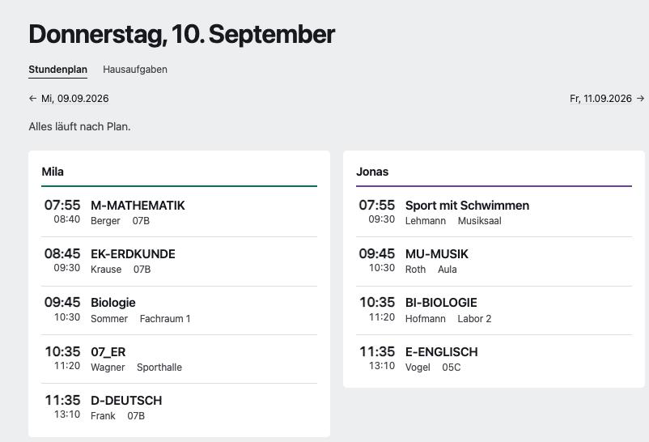
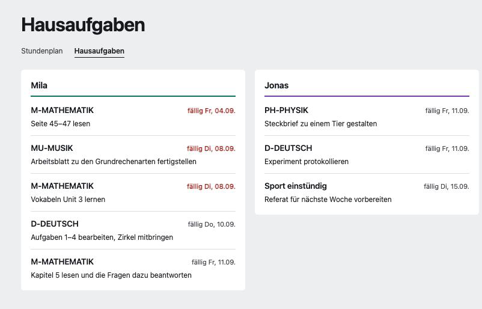

# WebUntis Dashboard

A single page showing today's WebUntis timetable for several students side by
side. Built for a phone at breakfast or a small screen in the hallway: what is
on today, and what changed.

Symfony 7, PHP-FPM, nginx. No database, no queue, no build step. The only
state - a filesystem cache, the admin-saved settings, which homework is
ticked off, and the push subscriptions with their key - lives under `var/`.

| Timetable | Homework |
| --- | --- |
|  |  |

<sub>Screenshots use made-up names and homework.</sub>

## How it works

WebUntis exposes the JSON-RPC endpoints that the official mobile app uses.
Schools enable different login paths, so both are supported:

| Method | Endpoint | Credentials |
| --- | --- | --- |
| `secret` | `POST /WebUntis/jsonrpc_intern.do?m=getUserData2017` | username + TOTP from the app secret |
| `password` | `POST /WebUntis/jsonrpc.do` (`authenticate`) | username + password |

Prefer `secret`. It is the path the Untis app itself takes and it keeps working
at schools that have switched the classic endpoint off. The secret is a base32
string from the WebUntis profile, under access sharing, shown as a QR code. TOTP
generation is implemented in `src/Untis/Totp.php` against RFC 6238, so no OTP
library is needed.

Both paths end up with a `JSESSIONID`, which the timetable request reuses.

## Setup

```bash
composer install --no-dev --optimize-autoloader
cp config/untis.yaml.dist config/untis.yaml
```

Edit `config/untis.yaml`: the server host, the school login name from the
WebUntis URL, one account block per login, one student block per child. If
your children are at different schools, set `server:`/`school:` on the
account block itself instead of at the top of the file - each account
already needs its own login, so this is the only extra step.

Then set a real `APP_SECRET` in `.env.local` and make `var/` writable by the
PHP-FPM user:

```bash
echo "APP_SECRET=$(openssl rand -hex 16)" > .env.local
mkdir -p var && chown -R www-data:www-data var
```

### Finding the element ids

A parent account is not itself a student, so each child needs an `element_id`.
Set `setup_token` in `config/untis.yaml` and visit
`/setup/<account-id>?token=<setup_token>` once — for the example config that is
`/setup/parent?token=...`. It returns the account's own element plus every
linked child:

```json
{
  "own_element": {"element_id": 42, "element_type": 5, "display_name": "Erika Musterfrau"},
  "children": [
    {"element_id": 1234, "display_name": "Mila"},
    {"element_id": 5678, "display_name": "Jonas"}
  ]
}
```

Copy the ids into the config. If `children` is empty and the account *is* the
student, leave `element_id` out entirely and the account's own element is used.
The `raw_user_data` field is there for the cases where a school's WebUntis
version names things differently.

The `/setup` route echoes account details, so it stays locked behind
`setup_token`: any request without a matching `?token=` gets a plain 404. Clear
the token from the config to disable the route entirely.

### Changing settings without editing the config

Language, light/dark appearance, cache/refresh timing and the optional
features can all be changed from a small form at
`/admin?token=<admin_token>`, set the same way as `setup_token` above. Which
subjects each student has hidden lives on its own page, linked from there,
at `/admin/subjects?token=<admin_token>` — kept apart from the general
settings since its checklist is built live from each student's own WebUntis
timetable over the next two weeks rather than just read from the config, so
there is nothing to type by hand there either. Both save to
`var/settings.yaml`, not `config/untis.yaml` — that file, and the
credentials in it, are never written to by the app. A saved setting wins
over the matching key in `config/untis.yaml`; delete `var/settings.yaml`
(or clear `admin_token` to lock both routes) to fall back to the config file
again.

## Deployment

The dashboard shows where two children are at any hour of the day. Put HTTP basic
auth, an IP allowlist, or your existing SSO in front of it, and serve it over
TLS only. `config/untis.yaml` holds credentials in cleartext, so it is gitignored
and should be `chmod 600` and owned by the PHP-FPM user (bare metal) or
mounted read-only (Docker).

### Bare metal

`docs/nginx.conf.example` is a complete vhost. Document root is `public/`,
everything routes through `index.php`, and PHP-FPM is the only moving part.

`docs/nginx.conf.example` caches everything under `/assets/` for 7 days, so
`{{ asset(...) }}` in the templates appends each file's own mtime as a `?v=`
query string (`App\Asset\MtimeVersionStrategy`). A deploy that touches
`style.css` changes that URL, so the browser fetches it immediately instead
of serving the old file for up to a week - no manual version bump, no build
step.

The IP allowlist and the dotfile block both `deny all`, which nginx answers
with a 403; `public/403.html` replaces its stock error page with one in the
app's own style. It is a plain static file nginx serves directly - no PHP,
no `t()` translations, so it is German+English in one rather than following
`locale`, and it follows the system light/dark setting only (no admin-saved
`theme` override, since nothing reads `untis.yaml` to render it).

A server-wide `deny all` (the IP allowlist) also denies nginx's own attempt
to fetch that page for the error response, and separately denies the
stylesheet and icon it links to - both are already worked around in
`docs/nginx.conf.example`/`docker/nginx.conf` with a couple of `allow all;`
overrides. Worth knowing if you write a custom `location` block of your own
that also needs to stay reachable behind the allowlist.

### Docker

`Dockerfile` builds one self-contained image - nginx and PHP-FPM in the same
container, no separate services to wire up. `composer install` runs once, at
build time; nothing else about the app needs a build step. `config/untis.yaml`
and `var/` (the cache, plus anything saved from `/admin`) are never baked into
the image; both are mounted at runtime instead, so the same image works for
every family without rebuilding it.

```bash
cp config/untis.yaml.dist config/untis.yaml   # fill it in, as above
cp .env.docker.dist .env.docker
echo "APP_SECRET=$(openssl rand -hex 16)" > .env.docker

docker compose up -d --build
```

The dashboard is then at `http://localhost:8080`. `docker-compose.yml` mounts
`config/untis.yaml` read-only and keeps `var/` in a named volume, so admin
settings and cache survive a restart or a rebuild after `git pull`. Without
Compose, the equivalent is:

```bash
docker build -t webuntis-dashboard .
docker run -d --name webuntis-dashboard \
    -p 8080:80 \
    -e APP_SECRET="$(openssl rand -hex 16)" \
    -v "$(pwd)/config/untis.yaml:/var/www/html/config/untis.yaml:ro" \
    -v webuntis-dashboard-var:/var/www/html/var \
    webuntis-dashboard
```

The container also runs the timetable change check (`bin/check-changes`,
see "Notifications on timetable changes") every five minutes in the
background; set `CHECK_CHANGES_INTERVAL` (seconds, `0` to switch it off) in
`.env.docker` to change that.

The container serves plain HTTP; put TLS, basic auth or an IP allowlist on
whatever reverse proxy sits in front of it, the same as the bare-metal setup
above. Starting it without `config/untis.yaml` mounted fails fast with a clear
error instead of a confusing 500 on every request.

## Options

| Key | Default | Effect |
| --- | --- | --- |
| `cache_ttl` | `300` | Seconds a fetched day is reused before WebUntis is asked again |
| `refresh_seconds` | `600` | Browser auto-reload interval; `0` disables it |
| `timezone` | `Europe/Berlin` | Decides which day "today" is |
| `locale` | `en` | UI language, `en` or `de` |
| `theme` | `system` | `system`, `light` or `dark` |
| `features.homework` | `true` | Homework view and its header tab |
| `features.exams` | `true` | Exams view and its header tab |
| `features.absences` | `true` | Absences view and its header tab |
| `features.free_periods` | `true` | Free-period markers in the timetable |
| `features.parents_day` | `true` | Parent-teacher day view and its header tab |
| `features.notifications` | `true` | Push notifications on timetable changes (see below) |

Every feature defaults to on; set the ones you don't want under `features:` in
`config/untis.yaml` (see `untis.yaml.dist`), or flip them from `/admin` (see
above). A disabled `/homework`, `/exams`, `/absences` or `/parents-day` 404s rather than
rendering empty, the same way `/setup` does without its token, and the header
only shows tabs for the views that are enabled.

`?day=tomorrow` or `?day=2026-09-14` shows another day. The header has a pager
to the previous and next school day; Saturdays and Sundays are stepped over.

`/week` switches to the week view: Monday-Friday of every student's
timetable at once, days stacked and each lesson a single compact line (time,
subject, room), so the whole school week is scannable without paging day by
day. Cancelled and substituted lessons are still flagged, just tersely -
`(fällt aus)`/`(Vertretung)` next to the subject rather than the day view's
full detail. Unlike homework/exams/absences it is not an optional feature
with its own toggle: it is another way of showing the same timetable data
`/` already fetches, so it shares the "Stundenplan" tab with `/` rather than
getting a tab of its own - a "Tag"/"Woche" pair right underneath switches
between the two. `?day=` picks any day in the target week the same way it
picks a day on `/`; the pager here steps a week at a time instead of a
school day, and shows the calendar week number ("KW 38") rather than a date.

`/homework` switches to the homework list: every student's outstanding
homework, sorted by due date, read from the mobile app's
`/WebUntis/api/homeworks/lessons` endpoint. Completed assignments (as
WebUntis itself sees them) are dropped. That feed names subjects by short
code only, so the next three weeks of timetable are read alongside it to
show the same long name the timetable does ("07_WP_BI" becomes "Biologie").

Each item has a checkbox to tick it off from the dashboard; done items move
to their own page, `/homework/done`, linked from `/homework` once there is
at least one, so the everyday list does not grow long with things that no
longer need attention. This is purely local (no login needed - anyone who
can load the page can tick a box): it is stored in `var/homework-done.yaml`,
keyed by WebUntis' own id for the assignment, and never written back to
WebUntis, so the official app still shows it as outstanding. Ids that stop
showing up in a fetch (the assignment aged out of the fetch window, or a
student ticked it off for real in the official app) are pruned from that
file automatically.

`/exams` switches to the exam list: every student's exams over the next 60
days, sorted by date, read from the mobile app's `/WebUntis/api/exams`
endpoint. That endpoint filters by class rather than by student, so each
exam's assigned-student list is checked instead, and subjects are resolved to
long names the same way homework's are.

`/absences` switches to the absences list: every student's absences over the
current school year to date (and up to 14 days ahead, for an already-planned
absence like a doctor's appointment), most recent first, read from the mobile
app's `/WebUntis/api/classreg/absences/students` endpoint, including the
reason, any excuse note and whether it has been excused yet. The school year's
own start and end dates come from WebUntis itself
(`getCurrentSchoolyear`), not an assumed calendar date, since not every school
starts on 1 August.

`/parents-day` lists the appointments booked for an open parent-teacher day
("Elternsprechtag", "LET" at some schools) as one timeline for the parents
rather than one column per student: every child's appointments merged per
event, grouped by day and sorted by time, each labelled with the child it is
for, plus the booking deadline while booking is still open. There is no
documented API for this; it reads the same `jsonrpc_web/jsonParentsDayService`
the WebUntis web UI uses (read methods only - the dashboard never books or
cancels anything), and finds which events exist from the links on the legacy
start page. Schools usually only open this shortly before the event, so most
of the year the view just says there is nothing to book.

All views are linked from the header.

The UI ships in English and German, set app-wide by `locale`. Strings live in
`translations/en.yaml` and `translations/de.yaml`.

## Notifications on timetable changes

The footer has a "Notify me of timetable changes" toggle. Pressed on a
phone or computer, that device gets a push notification whenever a lesson
in the next seven days is cancelled (or simply disappears), is back on,
moves to another room, gets another teacher, is cut short, is replaced by
another subject, or is added - one notification per child, tapping it opens
that day on the dashboard. A confirmation is pushed straight away when the
toggle is switched on, so a setup problem shows up right then.

This is plain [Web Push](https://www.rfc-editor.org/rfc/rfc8030), sent by
this server itself - no notification service to sign up with, no account,
no app to install:

- The server's signing key (VAPID) is generated on first use and stays in
  `var/push-vapid.pem`. Subscriptions are in `var/push-subscriptions.json`,
  the last seen timetable in `var/push-state.json`.
- The one thing that cannot be avoided is the browser vendor's own push
  relay - every push to an iPhone goes through Apple, to Chrome through
  Google, to Firefox through Mozilla; no website or app can reach a locked
  phone any other way. The payload is end-to-end encrypted (RFC 8291) with
  keys only this server and the subscribed browser hold, so the relay only
  ever sees ciphertext and when it was sent.
- iPhone/iPad (iOS 16.4 or later): Web Push only works for a page added to
  the home screen. Add it via Share → Add to Home Screen, open it from
  there, then use the toggle. In Safari itself the footer says so instead.

The checking is done by `bin/check-changes`: each run fetches today plus
the next seven days fresh from WebUntis (bypassing the cache), compares it
with the previous run, and pushes whatever is new. A change is reported
once, when it first appears, not on every run for as long as it stands. The
first run after the first subscription, a new student, a day just entering
the window, or a change to that student's hidden subjects only records a
baseline. When a notification is sent the dashboard cache is cleared too, so
the page it opens already shows the change. While nobody is subscribed (or
`features.notifications` is off) a run exits without asking WebUntis
anything.

Run it every five minutes as the PHP-FPM user (it shares `var/` with the
web app) - bare metal, in that user's crontab:

```
*/5 * * * * cd /var/www/webuntis-dashboard && php bin/check-changes
```

The Docker image runs it on its own (see Docker above).

Subscribing is not token-gated, the same as ticking off homework: anyone
who can open the dashboard can ask to be told about changes. The subscribe
endpoint only takes JSON (which another website cannot send without a CORS
preflight this app never answers) and only stores endpoints at the known
browser push services, so it cannot be used to make this server send
requests anywhere else.

## Home screen

The page carries a web app manifest (`/manifest.webmanifest`, a localised route)
and the Apple meta tags, so "Add to Home Screen" on a phone gives it an icon and
opens it without browser chrome. The icon is `public/icon.svg`; the PNG and ICO
sizes next to it are generated from it:

```bash
cd public
magick -background '#0F6E5C' -density 400 icon.svg -flatten -resize 180x180 -depth 8 -strip apple-touch-icon.png
magick -background '#0F6E5C' -density 400 icon.svg -flatten -resize 192x192 -depth 8 -strip icon-192.png
magick -background '#0F6E5C' -density 400 icon.svg -flatten -resize 512x512 -depth 8 -strip icon-512.png
magick -background '#0F6E5C' -density 400 icon.svg -flatten -strip -define icon:auto-resize=64,48,32,16 favicon.ico
```

The home screen label comes from `app.name` in the translation catalogues.

## Behaviour worth knowing

- Adjacent periods of the same lesson are merged, so a double period is one
  block from 08:00 to 09:30 rather than two rows. Periods more than five
  minutes apart stay separate, so real breaks survive.
- A gap of 30 minutes or more between two blocks gets its own row ("Free
  period, next lesson at 09:50"), so a day with a free period in the middle
  reads at a glance instead of requiring the reader to compare end and start
  times themselves. Shorter gaps are just ordinary passing time and stay
  silent.
- Cancelled lessons stay visible, struck through and marked. Removing them
  would hide the thing you opened the page for.
- Substitutions show the teacher who was replaced when WebUntis reports it.
- One student failing does not break the page. The error appears in that
  student's column and the other columns still render.
- The page follows the system's light/dark setting by default; `theme` (see
  Options, or `/admin`) pins it to light or dark instead. Every colour is a
  CSS custom property, redeclared once for dark mode.
- The footer's "Fetched at" time is when WebUntis was actually asked, not
  when the page happened to render - a page served from cache says so and
  shows how many minutes are left before the next visit asks WebUntis
  again.

## Possible next steps

- An iCal feed per student for the family calendar
- Per-device choice of which children to be notified about

## Layout

```
src/Untis/UntisClient.php       JSON-RPC + REST calls, both login paths, normalisation
src/Untis/Totp.php              RFC 6238 tokens from the app secret
src/Untis/ConfigLoader.php      Reads config/untis.yaml, layers var/settings.yaml over it
src/Untis/TimetableProvider.php Session reuse per account, caching, error isolation
src/Untis/Lesson.php            One timetable block
src/Untis/Homework.php          One outstanding homework assignment
src/Untis/HomeworkTracker.php   Local "done" marks, layered over Homework, never synced to WebUntis
src/Untis/Exam.php              One upcoming exam
src/Untis/Absence.php           One absence entry, past or ongoing
src/Untis/ParentsDay.php        One open parent-teacher day, with a student's booked appointments
src/Untis/ParentsDayAppointment.php     One booked parent-teacher slot
src/Push/ChangeNotifier.php     Timetable diff against the last run, one push per child with changes
src/Push/WebPush.php            VAPID + aes128gcm Web Push, openssl only, no library
src/Push/SubscriptionStore.php  Subscribed browsers in var/, endpoint allowlist
src/Asset/MtimeVersionStrategy.php      asset() cache-busting, keyed by file mtime
src/Controller/DashboardController.php  Dashboard, week view, homework, exams, absences, parent-teacher day, manifest, /setup helper
src/Controller/AdminController.php      /admin settings form and /admin/subjects, reads and saves via ConfigLoader
src/Controller/PushController.php       /push/subscribe and /push/unsubscribe
src/I18n/Translator.php         Two-language message catalogue, no framework i18n
src/Twig/I18nExtension.php      The t() Twig function
src/Twig/PushExtension.php      push_enabled() / push_public_key() for the footer toggle
bin/check-changes               One change check; cron (bare metal) or the entrypoint loop (Docker)
translations/{en,de}.yaml      UI strings, English and German
templates/dashboard.html.twig   The page
templates/admin.html.twig       The settings form
templates/admin_subjects.html.twig      The hide_subjects form
public/assets/style.css         The styles
public/assets/push.js           The footer notification toggle, the app's only page script
public/sw.js                    Service worker: shows pushes, opens the day on tap
public/icon.svg                 Home screen / favicon source (PNGs generated from it)
public/403.html                  Static error page for nginx's IP allowlist / dotfile-block denies
Dockerfile                      Single image: nginx + PHP-FPM, composer install at build time
docker/nginx.conf                       Container vhost, the plain-HTTP equivalent of docs/nginx.conf.example
docker/entrypoint.sh                    Fixes up var/ ownership, fails fast without config/untis.yaml, runs the change check loop
docker-compose.yml               Volumes + env_file wrapper around the image
```

## Author

Sven Culley — <sven@sense-design.de> ([sense-design.de](https://sense-design.de))

MIT licensed.
